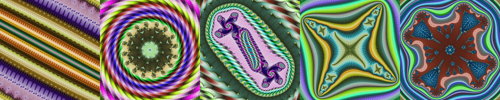

<h1 align="center">rust-fractal-core</h1>
<p align="center">
  <a href="https://github.com/rust-fractal/rust-fractal-core/blob/master/LICENSE"></a>
  <a href="https://github.com/rust-fractal/rust-fractal-core/"></a>
  <a href="https://github.com/rust-fractal/rust-fractal-core/releases"></a>
</p>

See the [changelog](CHANGELOG.md) for version history.

A UI-independent Mandelbrot computation workspace. The current refactor separates deterministic computation from native scheduling, numerical backends, and file export:

- `fractal-core`: typed render requests, deterministic tiles, raw iteration/smooth/distance channels, and precision policy.
- `fractal-runtime`: native Rayon scheduling, cancellation, and ordered progress events.
- `fractal-numerics`: portable extended-range arithmetic and the Malachite arbitrary-precision implementation used by reference-location calculations.
- `fractal-io`: JSON settings plus PNG, JPEG, and EXR export outside the numerical core.

The historical renderer remains documented in the changelog while its replacement is built around the new public domain API.

Minimal synchronous rendering:

```rust
use fractal_core::{
    ComplexCoordinate, RenderRequest, RenderSettings, Viewport, Zoom, compute_frame,
};

let request = RenderRequest {
    generation: 1,
    viewport: Viewport {
        center: ComplexCoordinate::new(-0.75, 0.0),
        zoom: Zoom::unit(),
        rotation_radians: 0.0,
        width: 800,
        height: 600,
    },
    settings: RenderSettings::default(),
};
let raw_frame = compute_frame(&request)?;
```

See [MIGRATION.md](MIGRATION.md) for the old renderer's responsibility mapping.

## Compiling
The repository pins Rust 1.97.1 in `rust-toolchain.toml`. Build and test on Windows with the pinned toolchain:

```text
cargo check --workspace --locked
cargo test --workspace --locked
```

Reference-location benchmarks use the Malachite arbitrary-precision path:

```text
cargo check -p fractal-numerics --features malachite --locked
cargo bench --bench arbitrary_reference --features malachite -- --quick
```

## Usage
There is no command-line renderer in the refactored workspace yet. Consumers construct a `fractal_core::RenderRequest`, compute a frame directly, or pass it to `fractal_runtime::RenderExecutor`; native output is handled by `fractal_io`.

## Acknowledgements
- claude (blog, Kalles Fraktaler 2+)
- pauldelbrot (glitch detection, nanoscope)
- knighty (superMB)


